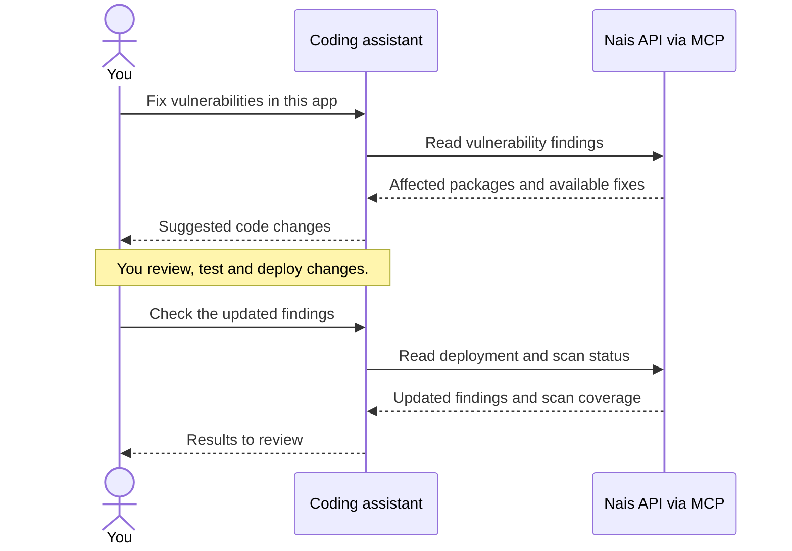

# SBOM and vulnerability detection

Nais connects known vulnerabilities to your deployed workloads.
Console and Nais API expose the findings, scan coverage and your team's assessments.

An **SBOM** lists the components in an image.
A **finding** means one of those components matches a known vulnerability.

## From image build to Console

- :package: **Your build**

    ---
    An SBOM lists the components in your image.
    Your build signs it and stores the attestation in the registry.

    [Generate an SBOM](../how-to/sbom.md)

- :telescope: **Vulnerability detection**

    ---
    Nais checks those components against known vulnerability data.
    New data triggers rescanning without a new build.

    [Understand the findings](#understand-and-assess-findings)

- :wrench: **Console and API**

    ---
    See findings for your deployed workloads in Console.
    Nais API makes the data available to other clients.

    [Open Console](<<tenant_url("console")>>) | [Explore Nais API](../../../operate/console/api.md)

Results update asynchronously when images or vulnerability data change.

??? note "SBOM format and scan scope"
    The SBOM (software bill of materials) uses CycloneDX.
    Its signed attestation binds it to the image digest; Nais verifies it before scanning.

    Coverage includes Applications and Jobs, including scaled-to-zero applications and jobs between runs, but not platform workloads or injected sidecars.

## Understand and assess findings

- :package: **Affected packages**

    ---
    See the package, vulnerability, severity and available fix.
    One vulnerability can affect several packages or workloads.

- :telescope: **Scan coverage**

    ---
    Distinguish completed scans from pending processing, missing SBOMs and failures.
    No findings does not necessarily mean a completed scan.

    [Understand coverage limits](#scan-coverage-is-not-a-clean-bill-of-health)

- :wrench: **Assessments and suppressions**

    ---
    Record your team's decision and the reason for a suppression.
    Suppression does not fix the vulnerability.

!!! example "One vulnerability, two workloads"
    Two workloads use the same image, which includes a library with a known vulnerability.
    Console reports a finding in each workload. These are two affected workloads, not two different vulnerabilities.
    If the advisory lists a fixed version, Console shows it.

A finding identifies an affected component; it does not by itself prove that vulnerable code is reachable or exploitable in your workload.

| Information | Meaning |
| --- | --- |
| Severity | Severity reported by the advisory source. |
| EPSS | FIRST's estimated probability of exploitation in the next 30 days. |
| KEV | Inclusion in CISA's Known Exploited Vulnerabilities catalog, not proof your workload is exploitable. |

Assessments and suppressions apply to a workload, environment, image repository, package and vulnerability.
They can survive package upgrades and image rebuilds within that scope; other workloads do not inherit them automatically.
Your team keeps its assessments valid as the application changes.

### Scan coverage is not a clean bill of health

!!! info "No findings does not mean no vulnerabilities"
    An image may be unresolved, its SBOM missing, or its scan pending or failed.
    Even a completed scan only finds matches supported by the SBOM and known vulnerability data.

## Use findings with your coding assistant

With the [Nais CLI's MCP server :octicons-link-external-16:](https://github.com/nais/cli/blob/main/MCP.md) configured and your repository open, you can ask: **"Fix vulnerabilities in this app."**

Nais MCP gives your coding assistant access to vulnerability findings so it can suggest fixes in your code.
You review and test the changes before deploying, then check the updated findings in Console.
The MCP server only reads data; it does not change your code, deploy or suppress findings.
